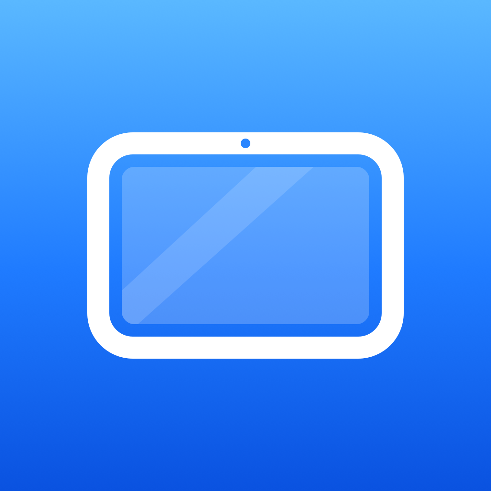

<p align="center">
  
</p>

<h1 align="center">WiredDisplay</h1>

<p align="center">
  Turn an iPad into a wired USB‑C display for your Mac, with sound, touch, keyboard and trackpad.<br>
  Adapts to any iPad on iPadOS 17 or later, and can even be the only screen of a headless Mac.
</p>

---

WiredDisplay is a macOS menu-bar app plus an iPadOS app. The Mac creates a
real virtual display, streams it to the iPad over the USB‑C cable, and takes
input back from the iPad. It works like Sidecar, but it runs only over the
cable, has its own pairing, and can be the main display of a Mac with no
monitor attached.

## Features

- **Wired only.** Video, audio and input travel through `usbmuxd` over the
  USB‑C cable. The app never falls back to Wi‑Fi, and the Mac opens no
  network port.
- **A real display.** A virtual display at the iPad's native resolution with
  HiDPI "looks like" sizes, including "more space" steps. It can be the main
  display of a headless Mac.
- **Picture quality presets.** HEVC with low-latency and full-detail lanes:
  - **Balanced**
  - **Pro:** 4:2:0, 10-bit
  - **Ultra:** 4:4:4, 10-bit
  - **High Color:** 4:4:4, 8-bit

  You can switch presets live from the menu bar. If an iPad can't decode a
  format, the Mac steps down for that iPad automatically.
- **Audio both ways.** Mac sound plays on the iPad speakers, and the iPad
  microphone can be used on the Mac. Both are optional and use an included
  audio driver.
- **Sidecar-style touch.**
  - Tap: click.
  - Drag: scroll, with momentum.
  - Hold, then drag: select or move.
  - Two-finger tap: right click.
  - Pinch: zoom.
  - Two-finger rotate: rotate.
  - Three-finger pinch, spread and swipe: copy, paste, undo and redo.
- **Magic Keyboard and trackpad.**
  - Full keyboard with key repeat.
  - Two-finger scrolling with trackpad phases and momentum.
  - Real macOS **pinch-to-zoom** and **rotate** gestures.
  - Secondary click.
- **Mac shortcuts iPadOS would keep.** These are sent to the Mac with Command:

  | On the iPad keyboard | The Mac receives |
  |---|---|
  | `⌃ Tab`, `⌃ ⇧ Tab` | `⌘ Tab`, `⌘ ⇧ Tab`. Hold `⌃` to keep cycling. |
  | `` ⌃ ` `` | `` ⌘ ` `` |
  | `⌃ Space` | `⌘ Space` (Spotlight) |
  | `⌃ ⇧ 3 / 4 / 5` | `⌘ ⇧ 3 / 4 / 5` (screenshots) |

  `⌃ ↑` and `⌃ ← / →` reach Mission Control and Spaces as they are.
- **Secure by default.**
  - Every session uses an Ed25519 / X25519 handshake and AES‑256‑GCM
    encryption.
  - You pair once with a 6-digit code shown on both screens.
  - Input from the iPad is off until you allow it in the menu.
- **Adapts to each iPad.** The iPad reports its panel size, pixel density,
  refresh rate and hardware HEVC support, and the Mac builds the display to
  match. The iPad's Controls panel shows the same details under **This iPad**,
  including the model identifier.
- **Opens at login**, so the Mac's screen appears on the iPad after a restart.

## Requirements

- A Mac running macOS 14 Sonoma or later. Apple Silicon is recommended.
- An iPad running iPadOS 17 or later, with a USB‑C **data** cable.
- Xcode 16 or later to build. The iPad app can be signed with a free Apple ID,
  but a build signed that way expires after 7 days.

## Install

### Ready-made package

Build the package with:

```bash
scripts/build-ipa.sh
```

```bash
SIGN_IDENTITY=- scripts/build-dmg.sh
```

This produces `dist/WiredDisplay-<version>.ipa` (the iPad app) and
`dist/WiredDisplay-<version>.dmg` (the Mac app and audio driver). Sideload the
IPA with [AltStore](https://altstore.io) or SideStore. AltStore re-signs it
with your own Apple ID and renews it in the background.

[docs/share/PANDUAN-INSTALASI.txt](docs/share/PANDUAN-INSTALASI.txt) is a
step-by-step guide in Indonesian.

### From source

```bash
# Mac host: builds, signs and installs ~/Applications/WiredDisplayHost.app
scripts/build-host-app.sh
open ~/Applications/WiredDisplayHost.app
```

```bash
# iPad app: builds, signs with your team and installs on the iPad on USB
scripts/install-ipad-app.sh
```

The iPad script finds your team from the "Apple Development" certificate in
the keychain and uses the first iPad connected over USB. Set `TEAM_ID`,
`DEVICE` and `BUNDLE_PREFIX` to override these.

### First run

1. Open WiredDisplay on the Mac. It lives in the menu bar.
2. Grant **Screen Recording**. Grant **Accessibility** too if you want input
   from the iPad.
3. Connect the iPad and open the WiredDisplay app on it.
4. Check that the 6-digit code is the same on both screens, then accept it on
   both.
5. Optional: in the Mac menu, turn on **Allow Input from iPad (touch,
   keyboard, trackpad)**.
6. Optional: choose a **Quality** preset.

For audio, run `Audio Driver/Install Audio Driver.command` from the DMG. It
asks for your admin password. Then pick **iPad Speaker** or **iPad
Microphone** in Sound settings.

## How it works

```
Mac (WiredDisplayHost)                              iPad (WiredDisplay)
CGVirtualDisplay ─► ScreenCaptureKit ─► VideoToolbox HEVC ─┐
CoreAudio loopback ───────────────────────────────────────┤  usbmuxd over USB‑C
CGEvent injection ◄── touch · keys · trackpad · gestures ──┤  encrypted, framed
                                                           └─► decode ─► AVSampleBufferDisplayLayer
```

| Path | What's there |
|---|---|
| `macOSHost/Host` | Menu-bar app: display, capture, encoder, input injection, audio bridge |
| `macOSHost/Display/CVirtualDisplay` | Objective-C shim for the private `CGVirtualDisplay` API. It is resolved at runtime and fails closed. |
| `iPadOSClient/WiredDisplayClient` | iPad app (SwiftUI and UIKit) |
| `Shared/` | Swift packages for the protocol, session crypto, usbmux, transport, video, geometry and audio |
| `MacVirtualDevices/` | The audio driver (AudioServerPlugIn) |
| `Tests/Unit` | Unit tests. Run them with `swift test` or `scripts/verify.sh`. |
| `docs/` | Decisions, change log, bug log, risks and the capability matrix |

## Limitations

- **Private and undocumented APIs.** `CGVirtualDisplay` and the trackpad
  gesture event layout are not public. A future macOS release may break
  them. The app is not sandboxed and not notarized.
- **Three- and four-finger trackpad swipes** stay with iPadOS and never reach
  the app.
- **After a Mac reboot**, the iPad sometimes does not show up on USB until the
  cable is unplugged for about 10 seconds and plugged back in. This is
  platform behaviour (BUG‑037).
- **Free Apple ID signing** expires after 7 days. AltStore renews it.
- **Older iPads** may not decode 4:4:4 or 10-bit video. If an iPad keeps
  failing, the Mac drops to 4:2:0 and then to 8-bit for that iPad
  automatically, and shows the limit in the Quality menu. Only an iPad Air
  13″ (M2) has been tested.

## Status

This is a personal project, tested on one Mac mini with an iPad Air 13″ (M2).
Design notes are in [docs/DECISIONS.md](docs/DECISIONS.md), and the history of
changes is in [docs/CHANGELOG.md](docs/CHANGELOG.md). Raw hardware test logs
are kept out of this repository.

---

🤖 Built with [Claude Code](https://claude.com/claude-code)
